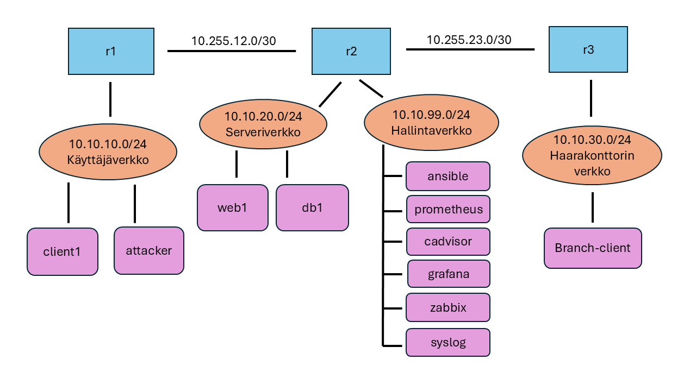

## 1. Johdanto
Tämän dokumentaation tarkoituksena on osoittaa miten kurssin verkkoympäristöön on tutustuttu sekä dokumentoida sen rakenne hyödynnettäväksi myös myöhemmissä harjoituksissa.

## 2. Verkkokaavio

## 3. Laiteluettelo
| Laite | Tarkoitus |
| r1 | Reititin 1, yhdistää käyttäjäverkon muuhun verkkoon. |
| r2 | Reititin 2, yhdistää muut reitittimet + palvelin- ja hallintaverkot |
| r3 | Reititin 3, yhdistää muun verkon haarakonttorin verkkoon |
| client1 | Käyttäjäverkon kone |
| attacker | Kone, jolla harjoitellaan hyökkäyksiä/tehdään tietoturvatestausta. Koneessa käytössä Kali Linux. |
| web1 | Web-palvelinkone |
| db1 | Tietokantapalvelinkone |
| branch-client | Haarakonttorin kone |
| ansible | Ansiblen käyttöön/hallintaan tarkoitettu kone. Ansiblella automatisoidaan verkonhallinnan tehtäviä. |
| prometheus | Palvelin, jonka avulla voi monitoroida järjestelmää |
| grafana | Palvelu, jolla voi visualisoida monitorointidataa |
| zabbix | Työkalu/palvelu jolla voidaan monitoroida verkkoa ja palveluita |
## 4. IP-suunnitelma
| Verkko | Tarkoitus | Yhdyskäytävä |
| 10.10.10.0/24 | Käyttäjäverkko, jossa sijaitsee r1, client1 ja attacker | 10.10.10.1/24 (reititin 1) |
| 10.10.20.0/24 | Serveriverkko, jossa sijaitsee r2, web1 ja db1 | 10.10.20.1 (reititin 2) |
| 10.10.30.0/24 | Haarakonttorin verkko, jossa sijaitsee r3 ja branch-client | 10.10.30.1 (reititin 3) |
| 10.10.99.0/24 | Hallintaverkko, jossa sijaitsee r2, ansible, prometheus, cadvisor, grafana, zabbix ja syslog | 10.10.99.1 (reititin 2) |
| 10.255.12.0/30 | Reitittimien r1 ja r2 välinen yhteys | 10.255.12.1 (reititin 1), 10.255.12.2 (reititin 2) |
| 10.255.23.0/30 | Reitittimien r2 ja r3 välinen yhteys | 10.255.23.1 (reititin 2), 10.255.23.2 (reititin 3) |
## 5. Reitityksen analyysi
Löytyykö yhteys kaikkiin verkkoihin?: Yhteys löytyy kaikkiin verkkoihin, yhteystesteissä tuloksena 4 packets transmitted, 4 received, 0% packet loss

Mitä reittiä liikenne kulkee ja mitä reitittimiä reitille kuuluu?: Liikenne client1:stä (10.10.10.101) kulkee r1 (10.10.10.1) -> r2 (10.255.12.2) -> r3 (10.255.23.2) -> branch-client (10.10.30.101) eli reitille kuuluu reitittimet 1, 2 ja 3.

line vtysanna@Sanna:~/Verkonhadocker exec -it clab-hamk-verkonhallinta-golden-client1 bashnt1 bash
root@client1:/# ip addr
1: lo: <LOOPBACK,UP,LOWER_UP> mtu 65536 qdisc noqueue state UNKNOWN group default qlen 1000
    link/loopback 00:00:00:00:00:00 brd 00:00:00:00:00:00
    inet 127.0.0.1/8 scope host lo
       valid_lft forever preferred_lft forever
    inet6 ::1/128 scope host
       valid_lft forever preferred_lft forever
31: eth0@if32: <BROADCAST,MULTICAST,UP,LOWER_UP> mtu 1500 qdisc noqueue state UP group default
    link/ether 02:42:ac:14:14:0d brd ff:ff:ff:ff:ff:ff link-netnsid 0
    inet 172.20.20.13/24 brd 172.20.20.255 scope global eth0
       valid_lft forever preferred_lft forever
    inet6 fe80::42:acff:fe14:140d/64 scope link
       valid_lft forever preferred_lft forever
60: eth1@if59: <BROADCAST,MULTICAST,UP,LOWER_UP> mtu 9500 qdisc noqueue state UP group default
    link/ether aa:c1:ab:3e:05:d6 brd ff:ff:ff:ff:ff:ff link-netnsid 1
    altname clab-o-05031180f95d8850
    inet 10.10.10.101/24 scope global eth1
       valid_lft forever preferred_lft forever
    inet6 fe80::a8c1:abff:fe3e:5d6/64 scope link
       valid_lft forever preferred_lft forever
root@client1:/# ip route
default via 10.10.10.1 dev eth1
10.10.10.0/24 dev eth1 proto kernel scope link src 10.10.10.101
172.20.20.0/24 dev eth0 proto kernel scope link src 172.20.20.13
root@client1:/# ping -c 4 10.10.20.101
PING 10.10.20.101 (10.10.20.101) 56(84) bytes of data.
64 bytes from 10.10.20.101: icmp_seq=1 ttl=62 time=0.645 ms
64 bytes from 10.10.20.101: icmp_seq=2 ttl=62 time=0.134 ms
64 bytes from 10.10.20.101: icmp_seq=3 ttl=62 time=0.071 ms
64 bytes from 10.10.20.101: icmp_seq=4 ttl=62 time=0.060 ms

--- 10.10.20.101 ping statistics ---
4 packets transmitted, 4 received, 0% packet loss, time 2997ms
rtt min/avg/max/mdev = 0.060/0.227/0.645/0.242 ms
root@client1:/# ping -c 4 10.10.30.101
PING 10.10.30.101 (10.10.30.101) 56(84) bytes of data.
64 bytes from 10.10.30.101: icmp_seq=1 ttl=61 time=0.611 ms
64 bytes from 10.10.30.101: icmp_seq=2 ttl=61 time=0.071 ms
64 bytes from 10.10.30.101: icmp_seq=3 ttl=61 time=0.158 ms
64 bytes from 10.10.30.101: icmp_seq=4 ttl=61 time=0.087 ms

--- 10.10.30.101 ping statistics ---
4 packets transmitted, 4 received, 0% packet loss, time 2999ms
rtt min/avg/max/mdev = 0.071/0.231/0.611/0.221 ms
root@client1:/# traceroute 10.10.30.101
traceroute to 10.10.30.101 (10.10.30.101), 30 hops max, 60 byte packets
 1  10.10.10.1 (10.10.10.1)  0.789 ms  0.580 ms  0.566 ms
 2  10.255.12.2 (10.255.12.2)  0.557 ms  0.384 ms  0.361 ms
 3  10.255.23.2 (10.255.23.2)  0.326 ms  0.223 ms  0.202 ms
 4  10.10.30.101 (10.10.30.101)  0.171 ms  0.149 ms  0.112 ms

## 6. Yhteenveto
Dokumentaation muodostamisessa eniten aikaa meni oikeiden komentojen löytämiseen sekä niiden tuloksista tarpeellisen tiedon poimimiseen. Monet komennot antavat tulokseksi hyvin paljon tekstiä, ja etenkin kun kokemusta ei aiheesta ole, vei aikaa löytää seasta oleellinen tieto. Kokemuksen puute näkyi myös oikeita komentoja etsiessä, kun aikaa meni myös sen tarkastamiseen että löydetty komento on tarkoitukseen sopiva ja sen avulla saa tarpeellisen tiedon.

Palvelusta vastaava it-asiantuntija voi työssään hyödyntää dokumentaatiota siihen, että hän pystyy siitä nopeasti hahmottamaan verkon rakenteen, laitteet sekä IP-osoitteet. Erityisesti vikatilanteiden selvittelyssä tämä helpottaa työtä. 
